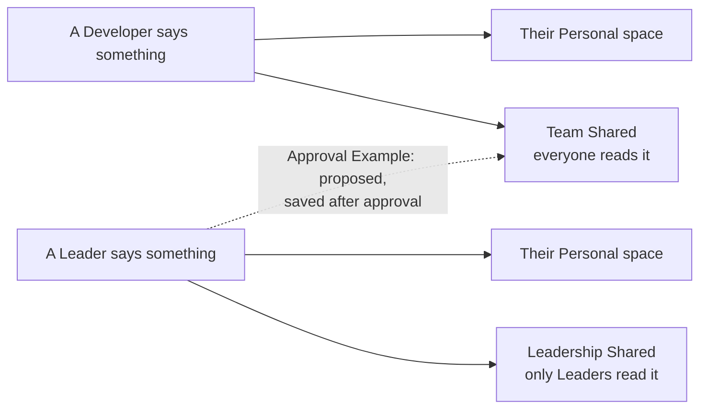
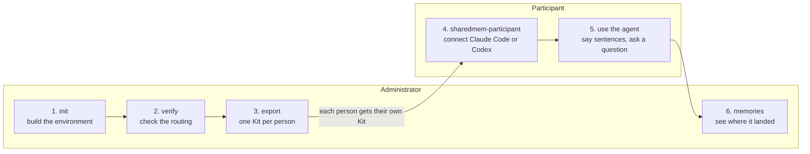

# Shared-memory demo

A hands-on demo of mem9 shared memory (Space Chains) for a small team. Each person works with their own coding agent, Claude Code or Codex. What they say is saved as Memories, and mem9 routes the lasting facts to the right shared spaces:

- **Team knowledge** goes to a shared space everyone reads (**Team Shared**).
- **Leadership matters** go to a shared space only Leaders read (**Leadership Shared**).
- **Personal preferences** stay in each person's own space.

Use it to:

- rehearse a team on a mem9 server;
- check that the routing does what you intend;
- hand each person a ready-to-run Kit.

Two small command-line programs do the work. They need Node 22 or newer and nothing else.

Four words you will meet:

- **Space**: stores Memories.
- **Chain**: lets one person read several Spaces as one, their own and the shared ones.
- **Kit**: the folder you give one person.
- **Example**: one of two routing setups, Basic or Approval.

[Concepts](docs/concepts.md) explains them in full.

## What you will see



- Only lasting facts are saved. Chatter is ignored.
- A person's Chain sets what they can read: a Developer's Chain holds their Personal space and Team Shared, so Developers cannot read Leadership Shared; a Leader's Chain also holds it.
- A language model decides which facts are copied into a shared space. It reads one short Routing prompt per shared space, and you can edit the prompts.

| Someone says | It is saved in |
| --- | --- |
| "We always run database migrations before deploying the API." (a Developer) | Their Personal space and Team Shared |
| "We approved a forty thousand dollar budget for the payments vendor migration." (a Leader) | Their Personal space and Leadership Shared |
| "Starting Monday, all production deploys require two reviewers." (a Leader) | Basic Example: their Personal space only. Approval Example: also proposed to Team Shared |
| "I prefer a dark theme in my editor." (anyone) | Their Personal space only |

## What you need

- Node 22 or newer.
- The address of a mem9 server that has the Space Chain API (the `server/` of [mem9-ai/mem9](https://github.com/mem9-ai/mem9) serves it under `/v1alpha2/space-chains`). The Administrator needs it; each Kit already carries it.
- Claude Code or Codex on each Participant's computer.

> **Use fictional data only.** Every person and sentence in the demo is fictional, and a mem9 server may use plain HTTP, so never type anything real.

## The flow

Two roles take part:

- The **Administrator** builds the environment and hands out Kits.
- A **Participant** receives a Kit, connects their coding agent with it, then uses the agent as usual.



### 1. Build the environment (Administrator)

Create everything the demo needs on the server.

```
cp .env.example .env          # set SHAREDMEM_API_URL in .env to your server (git ignores the file)
./bin/sharedmem-admin init
```

`init` creates:

- a Personal space and a Chain for every person;
- the two shared spaces;
- the three Routing prompts, from `config/routing-prompts/`;
- a few Seed memories for the sample questions to find.

It shows its plan and asks before it changes anything. It takes a minute or two.

### 2. Check the routing (Administrator)

Routing is a language model reading a Routing prompt, so check it before anyone depends on it.

```
./bin/sharedmem-admin verify
```

`verify`:

- sends 12 sample sentences through the real routing;
- compares where each one landed with where it should;
- removes the Memories it wrote.

It takes a few minutes. A language model makes the decision, so one run can differ from the next: if a Case fails, run `verify` once more before you change anything. If it keeps failing, [tune the Routing prompts](#tune-the-routing-prompts).

### 3. Hand out the Kits (Administrator)

Give each person what they need to connect, and nothing else.

```
./bin/sharedmem-admin export
```

`export` builds one Kit per person in `out/kits/<name>/`. A Kit holds:

- the Participant program;
- that person's own key;
- their sample sentences;
- a guide.

Send each person only their own Kit, for example as a zip. A Kit holds a key, so treat it as a secret. To rehearse alone, run one Kit yourself in a scratch directory (step 4).

### 4. Connect the agent (Participant)

Connect the person's coding agent to the shared memory.

```
./bin/sharedmem-participant
```

The program:

- asks which agent (Claude Code or Codex) and which project directory;
- shows what it will change and waits for a yes;
- installs the mem9 plugin for that project, with the server address, the person's key and their name;
- prints the directory to open, the sample sentences and the sample question.

It never starts the agent.

Codex also needs changes outside the project: the plugin's user-level credentials file, which holds the key, and the user's Codex hook files. The program may also run `git init` in the project. The plan lists every change before it asks.

The first time Codex starts in the project, it asks the person to trust the folder and to review the plugin's hooks. The hooks do nothing until they are trusted, so the program prints the answers to give.

### 5. Use the agent (Participant)

Try it as a normal user:

1. Start the agent from the directory the program printed.
2. Say the sample sentences in a normal chat.
3. After about a minute, ask the sample question.

Developers find what the team knows and never see Leadership Shared. Leaders see both. The Kit's guide has the details; it is [docs/participant-guide.md](docs/participant-guide.md).

### 6. Watch it land (Administrator)

See where the sentences ended up.

```
./bin/sharedmem-admin memories                 # Memory counts per space
./bin/sharedmem-admin memories --space team-shared
./bin/sharedmem-admin memories --as ana        # what one person sees through their Chain
```

When the rehearsal is over, `./bin/sharedmem-admin teardown` deletes the Chains. The server cannot delete Spaces, so they and their Memories stay.

## Tune the Routing prompts

The Routing prompts decide what reaches the shared spaces. They are plain-text files in `config/routing-prompts/`:

| File | Decides |
| --- | --- |
| `team-shared-auto.txt` | Which of a Developer's facts are copied to Team Shared |
| `leadership-shared-auto.txt` | Which of a Leader's facts are copied to Leadership Shared |
| `team-shared-approval.txt` | Which of a Leader's facts are proposed to Team Shared (Approval Example only) |

To change one:

1. Edit the file: plain text, at most 1,200 characters.
2. Run `init` to apply it. Chains, keys and Kits stay as they are.
3. Run `verify` again.

Do this when `verify` keeps failing, or when you want the team to behave differently. [Routing prompts](docs/routing-prompts.md) explains how to write a good prompt and how the Cases check it.

## The Approval Example

The two Examples differ in what happens to a Leader's team-wide announcement:

- **Basic** (the default): it stays in the Leader's Personal space.
- **Approval**: it is not published to Team Shared. It becomes a **Candidate** that the Administrator approves first. This shows how a mem9 server can hold a fact back for a person to decide.

Switching:

- You can switch between the two without changing any key.
- Kits already handed out keep working. Run `export` again to refresh the Example named inside them.

```
./bin/sharedmem-admin init --example approval
./bin/sharedmem-admin webhook set --url https://receiver.invalid/   # a placeholder is enough to rehearse
./bin/sharedmem-admin receiver serve                                # leave running in its own terminal
./bin/sharedmem-admin simulate --leader lucia --text "Starting Monday, all production deploys require two reviewers."
./bin/sharedmem-admin candidates                                    # see it
./bin/sharedmem-admin candidates approve c1                         # writes it into Team Shared
```

Real deliveries from the server need a public HTTPS address, such as a tunnel to the receiver's port. See [Receiving real deliveries](docs/administrator-guide.md#receiving-real-deliveries).

## Make it your own

Everything the demo ships is a plain file under `config/`. Each command explains what it changes with `--help`.

| To change | Edit | Then |
| --- | --- | --- |
| Who takes part (default: 2 Leaders, 4 Developers) | `config/cast.json`, or `init --cast <file>` (pass it on every `init`) | `init`, then `export` |
| What gets routed where | `config/routing-prompts/*.txt` | `init`, then `verify` |
| The sentences `verify` checks; Cases named T1, L1, W1, N1 and so on are also handed to people | `config/cases.json` (`verify --cases <file>` checks another file once) | `verify`, then `export` |
| The facts the sample questions find | `config/seed-memories.json` | `init` |

## Documentation

- [Administrator guide](docs/administrator-guide.md): every command, with a typical rehearsal to start from.
- [Participant guide](docs/participant-guide.md): what a Participant does with a Kit. Each Kit includes it as its `README.md`.
- [Routing prompts](docs/routing-prompts.md): which prompt does what, how to change one, how `verify` checks it.
- [Concepts](docs/concepts.md): Spaces, Chains, keys, Node modes, Examples.
- [Known gaps](docs/known-gaps.md): what the demo does not do or cannot guarantee.
- [Troubleshooting](docs/troubleshooting.md): a lost state file, a rejected webhook address, a session started in the wrong directory, and more.

## Development

- `pnpm test` runs the suite.
- The tests are hermetic: they start the real programs against a fake mem9 server on a local port, with stand-in `claude` and `codex` commands, inside a temporary directory.
- [AGENTS.md](AGENTS.md) describes the layout rules and conventions.

```
bin/        the two launchers
config/     shipped content: cast, Routing prompts, Cases, Seed memories, sample questions
docs/       the guides
src/        administrator, participant, shared and testing support; tests sit beside the code
state/      created by the Administrator program, holds every key (git-ignored)
out/        created by export: Kits and the report (git-ignored)
```

## License

[Apache-2.0](LICENSE), the same license as mem9.
