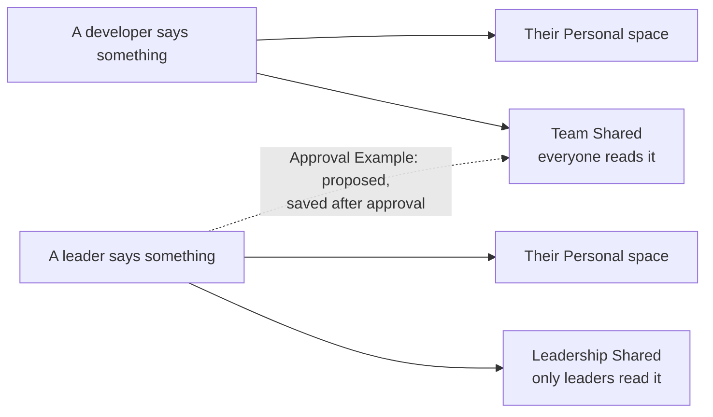
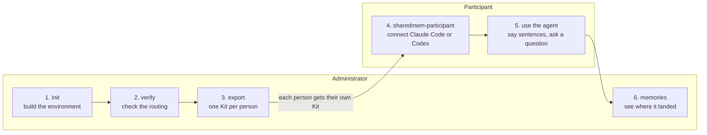

# Shared-memory demo

This demo shows how mem9 shared memory (Space Chains) works for a small team. Each person talks to their own coding agent, Claude Code or Codex. What the whole team should know flows into a **Team Shared** space. What only leaders should know goes to a **Leadership Shared** space that developers cannot read. Personal preferences stay personal.

Use it to rehearse a team on a mem9 server, check that the routing rules do what you intend, and hand each person a ready-to-run Kit. Two small command-line programs do the work, with no dependencies beyond Node 22 or newer.

Four words come up below. A **Space** stores Memories. A **Chain** lets one person read several Spaces as one: their own and the shared ones. A **Kit** is the folder you give one person. An **Example** is one of two routing setups, Basic or Approval. [Concepts](docs/concepts.md) explains them fully.

## What you will see



Only lasting facts are saved. A developer's Chain holds their Personal space and Team Shared; a leader's Chain also holds Leadership Shared, which is why developers cannot read it. For each fact, a language model reads a short prompt per shared space, which you can edit, and decides whether the fact belongs there. Chatter is ignored.

| Someone says | It is saved in |
| --- | --- |
| "We always run database migrations before deploying the API." (a developer) | Their Personal space and Team Shared |
| "We approved a forty thousand dollar budget for the payments vendor migration." (a leader) | Their Personal space and Leadership Shared |
| "Starting Monday, all production deploys require two reviewers." (a leader) | Basic Example: their Personal space only. Approval Example: also proposed to Team Shared |
| "I prefer a dark theme in my editor." (anyone) | Their Personal space only |

## What you need

- Node 22 or newer.
- The address of a mem9 server that has the Space Chain API (the `server/` of [mem9-ai/mem9](https://github.com/mem9-ai/mem9) serves it under `/v1alpha2/space-chains`). The Administrator needs it; each Kit already carries it.
- Claude Code or Codex on each Participant's computer.

Every person and every sentence in the demo is fictional. A server may use plain HTTP, so never type anything real.

## The flow

There are two roles. The **Administrator** builds the environment and hands out Kits. A **Participant** receives a Kit, connects their coding agent with it and then uses the agent as usual.



### 1. Build the environment (Administrator)

`init` creates what the demo needs on the server: a Personal space and a Chain for every person, the two shared spaces, the three routing prompts from `config/routing-prompts/` and a few Seed memories for the sample questions to find. It shows its plan and asks before it changes anything. It takes a minute or two.

```
cp .env.example .env          # then set SHAREDMEM_API_URL in .env to your server (git ignores the file)
./bin/sharedmem-admin init
```

### 2. Check the routing (Administrator)

Routing is a language model reading a short prompt per shared space, so check it before anyone depends on it. `verify` sends 12 sample sentences through the real routing and compares where each one landed with where it should. It takes a few minutes and removes the Memories it wrote.

```
./bin/sharedmem-admin verify
```

A language model makes the decision, so one run can differ from the next: run `verify` once more before you change anything. If a Case keeps failing, [tune the routing prompts](#tune-the-routing-prompts).

### 3. Hand out the Kits (Administrator)

`export` builds one Kit per person in `out/kits/<name>/`: the Participant program, that person's own key, their sample sentences and a guide. Send each person only their own Kit, for example as a zip. A Kit holds a key, so it is a secret.

```
./bin/sharedmem-admin export
```

To rehearse alone, run one Kit yourself in a scratch directory (step 4).

### 4. Connect the agent (Participant)

The Participant opens their Kit and runs its program. It asks which agent (Claude Code or Codex) and which project directory, shows what it will change and waits for a yes. It installs the mem9 plugin for that project and writes the server address, the person's key and their name there. For Codex it also saves a profile in the user's mem9 folder and may run `git init` in the project; it lists every change before it asks. It never starts the agent, and when it finishes it prints the directory to open, the sample sentences and the sample question.

```
./bin/sharedmem-participant
```

### 5. Use the agent (Participant)

The Participant starts the agent from the configured directory, says the sample sentences the program printed in a normal chat and, after about a minute, asks the sample question. Developers find what the team knows and never see Leadership Shared. Leaders see both. The Kit's guide, which is [docs/participant-guide.md](docs/participant-guide.md), has the details.

### 6. Watch it land (Administrator)

```
./bin/sharedmem-admin memories                 # Memory counts per space
./bin/sharedmem-admin memories --space team-shared
./bin/sharedmem-admin memories --as ana        # what one person sees through their Chain
```

When the rehearsal is over, `./bin/sharedmem-admin teardown` deletes the Chains. The server cannot delete Spaces, so they and their Memories stay.

## Tune the routing prompts

The routing prompts decide what reaches Team Shared and Leadership Shared. They are three plain-text files in `config/routing-prompts/`:

| File | Decides |
| --- | --- |
| `team-shared-auto.txt` | Which of a Developer's facts are copied to Team Shared |
| `leadership-shared-auto.txt` | Which of a Leader's facts are copied to Leadership Shared |
| `team-shared-approval.txt` | Which of a Leader's facts are proposed to Team Shared (Approval Example only) |

Change one when `verify` keeps failing or when you want the team to behave differently: edit the file (plain text, at most 1,200 characters), run `init` to apply it (Chains, keys and Kits stay as they are), then run `verify` again. [Routing prompts](docs/routing-prompts.md) explains how to write a good one and how the Cases check it.

## The Approval Example

The default is the **Basic** Example. In the **Approval** Example a leader's team-wide announcement is not published to Team Shared. It becomes a **Candidate** that the Administrator approves first, which shows how a mem9 server can hold a fact back for a person to decide. You can switch back and forth without changing any key, and Kits already handed out keep working (run `export` again to refresh the Example named inside them).

```
./bin/sharedmem-admin init --example approval
./bin/sharedmem-admin webhook set --url https://receiver.invalid/   # a placeholder is enough to rehearse
./bin/sharedmem-admin receiver serve                                # leave running in its own terminal
./bin/sharedmem-admin simulate --leader lucia --text "Starting Monday, all production deploys require two reviewers."
./bin/sharedmem-admin candidates                                    # see it
./bin/sharedmem-admin candidates approve c1                         # writes it into Team Shared
```

Real deliveries from the server need a public HTTPS address, such as a tunnel to the receiver's port. See [Receiving real deliveries](docs/administrator-guide.md#receiving-real-deliveries).

## Make it your own

Everything the demo ships is a plain file under `config/`, and each command explains what it changes with `--help`.

| To change | Edit | Then |
| --- | --- | --- |
| Who takes part (default: 2 leaders, 4 developers) | `config/cast.json`, or `init --cast <file>` (pass it on every `init`) | `init`, then `export` |
| What gets routed where | `config/routing-prompts/*.txt` | `init`, then `verify` |
| The sentences `verify` checks; Cases named T1, L1, W1, N1 and so on are also handed to people | `config/cases.json` (`verify --cases <file>` checks another file once) | `verify`, then `export` |
| The facts the sample questions find | `config/seed-memories.json` | `init` |

## Documentation

- [Administrator guide](docs/administrator-guide.md): every command, the working directory, the cast, cleaning up.
- [Participant guide](docs/participant-guide.md): what a Participant does with a Kit. Each Kit includes it as its `README.md`.
- [Routing prompts](docs/routing-prompts.md): which prompt does what, how to change one, how `verify` checks it.
- [Concepts](docs/concepts.md): Spaces, Chains, keys, Node modes, Examples.
- [Known gaps](docs/known-gaps.md): what the demo does not do or cannot guarantee.
- [Troubleshooting](docs/troubleshooting.md): a lost state file, a rejected webhook address, a session started in the wrong directory, and more.

## Development

`pnpm test` runs the suite. The tests are hermetic: they start the real programs against a fake mem9 server on a local port and stand-in `claude` and `codex` commands, inside a temporary directory. [AGENTS.md](AGENTS.md) describes the layout rules and conventions.

```
bin/        the two launchers
config/     shipped content: cast, routing prompts, Cases, Seed memories, sample questions
docs/       the guides
src/        administrator, participant, shared and testing support; tests sit beside the code
state/      created by the Administrator program, holds every key (git-ignored)
out/        created by export: Kits and the report (git-ignored)
```
